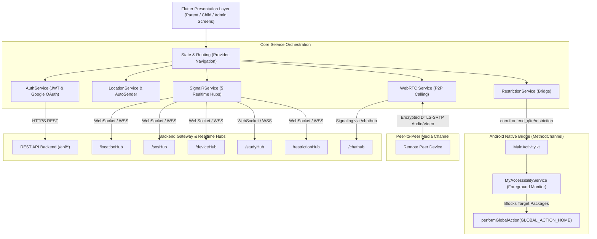

<div align="center">

# QLTE - Smart Child Protection & Remote Monitoring Platform

### Cross-platform mobile ecosystem featuring real-time GPS tracking, 5-Hub SignalR telemetry, WebRTC P2P audio/video calling, native Android accessibility firewall, and emergency SOS rapid response.

[](https://flutter.dev/)
[](https://dart.dev/)
[](https://learn.microsoft.com/aspnet/core/signalr/)
[](https://webrtc.org/)
[](https://maps.google.com/)
[](docs/DEPLOYMENT_GUIDE.md)
[](LICENSE)

[Quickstart](#quickstart) · [System Highlights](#system-highlights) · [Application Architecture](#application-architecture) · [Documentation Hub](#documentation-hub) · [Deployment & Build](#deployment--build) · [License](#license)

</div>

---

> [!IMPORTANT]
> **Production Runtime Notice:** The child safety engine requires persistent background location permissions (`ACCESS_BACKGROUND_LOCATION`) and the native Android Accessibility Service (`MyAccessibilityService`) to enforce app blocking and study schedules. Please grant overlay and accessibility permissions on child devices during initial onboarding.

---

## System Highlights

| Capability | Module | Technical Description |
| :--- | :--- | :--- |
| **Real-Time GPS Tracking & Geofencing** | `LocationHub` & `LocationService` | Dual-engine map rendering (Google Maps & Flutter Map / OpenStreetMap) with background telemetry, dynamic Safe Zone and Danger Zone perimeter evaluation, and breach notifications. |
| **Emergency SOS Rapid Dispatch** | `SOSHub` & `SosSender` | One-tap emergency escalation that plays siren audio (`audioplayers`), triggers haptic vibration (`vibration`), and broadcasts coordinate packets with high priority over SignalR. |
| **Native Android Accessibility Firewall** | `MyAccessibilityService` & `MethodChannel` | Custom Android `AccessibilityService` that inspects foreground window state changes (`TYPE_WINDOW_STATE_CHANGED`) to intercept restricted applications and redirect to home during focus hours. |
| **WebRTC Audio & Video Calling** | `CallScreen` & `flutter_webrtc` | Direct peer-to-peer audio and video communication with low latency, using SignalR `/chathub` for SDP offer/answer negotiation and ICE candidate exchange. |
| **Multi-Hub Realtime Telemetry** | `SignalRService` | Five specialized SignalR hubs (`locationHub`, `sosHub`, `deviceHub`, `studyHub`, `restrictionHub`) with automatic reconnection and group isolation per child and device ID. |
| **Academic & Focus Scheduler** | `StudyPeriodService` & `ScheduleService` | Configurable study hours and exam timetable management with automated lockouts, reminders, and synchronized parental notifications. |
| **Role-Based Access Control & Auditing** | `AuthService` & Admin Dashboard | Multi-role authorization (Child, Parent, Admin) supporting email/password and Google OAuth 2.0, with administrative token inspection and session revocation. |

---

## Application Architecture

The mobile application connects to backend services and native OS layers through a modular, decoupled architecture:



---

## Quickstart

### 1. Clone & Configure Environment

```bash
git clone https://github.com/hoangfhisp/QLTEUI_Flutter.git
cd QLTEUI_Flutter
```

Copy the environment template:

```bash
cp .env.example .env
```

Configure your gateway endpoints in `.env`:

```env
BASE_URL=https://your-api-gateway.com/api/
URL_SERVER=https://your-signalr-server.com/api/
CLIENT_ID_GOOGLE=your_google_client_id.apps.googleusercontent.com
SERVER_CLIENT_ID_GOOGLE=your_google_server_client_id.apps.googleusercontent.com
```

### 2. Install Dependencies

```bash
flutter pub get
```

### 3. Launch Application

```bash
# Debug Mode
flutter run

# Release Mode on Connected Device
flutter run --release
```

---

## Documentation Hub

Deep-dive operational and technical documentation is organized in the [`docs/`](docs/) directory:

| Document | Description |
| :--- | :--- |
| [**System Design & Mobile Architecture**](docs/SYSTEM_DESIGN.md) | Component architecture, execution pipeline, and end-to-end Emergency SOS workflow diagram. |
| [**Real-Time SignalR Hubs & WebRTC**](docs/REALTIME_SIGNALR_HUBS.md) | Catalog of 5 SignalR hubs, event models, automatic reconnect handling, and WebRTC signaling sequence. |
| [**Native Android Accessibility Firewall**](docs/ANDROID_ACCESSIBILITY_FIREWALL.md) | MethodChannel integration, foreground window interception, and package blocking logic. |
| [**RESTful API & DTO Specifications**](docs/REST_API_SPECIFICATION.md) | Endpoint catalog for authentication, child telemetry, geofencing, device control, and JSON DTOs. |
| [**State Management & Security**](docs/STATE_AND_SECURITY.md) | Role-Based Access Control (RBAC), JWT token rotation, session revocation, and data encryption. |
| [**Build & Deployment Guide**](docs/DEPLOYMENT_GUIDE.md) | Step-by-step instructions for Android split APKs, App Bundles (AAB), and permissions configuration. |

---

## Deployment & Build

* **Android Split APKs**: Generate architecture-specific binaries (`arm64-v8a`, `armeabi-v7a`, `x86_64`) via `flutter build apk --split-per-abi --release`.
* **Google Play Bundle**: Produce an optimized Android App Bundle using `flutter build appbundle --release`.
* **Testing & Linting**: Validate code quality with `flutter analyze`.

---

## License

This project is licensed under the [MIT License](LICENSE).
