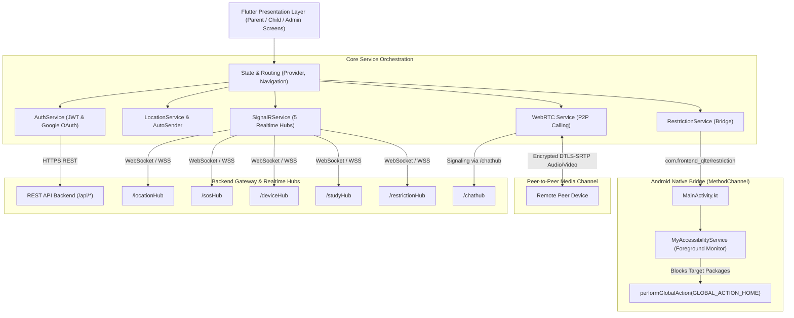

<div align="center">

# QLTE - Smart Child Protection & Remote Monitoring Platform

### Comprehensive cross-platform mobile ecosystem engineered to protect children 24/7 with real-time GPS geofencing, native Android accessibility firewall, 1-tap SOS emergency dispatch, and peer-to-peer WebRTC video calling.

[](https://flutter.dev/)
[](https://dart.dev/)
[](https://learn.microsoft.com/aspnet/core/signalr/)
[](https://webrtc.org/)
[](https://maps.google.com/)
[](docs/DEPLOYMENT_GUIDE.md)
[](LICENSE)

[Project Overview](#project-overview) · [Core Capabilities](#core-capabilities--what-can-qlte-do) · [Role Matrix](#role-based-feature-matrix) · [System Highlights](#system-highlights) · [Architecture](#application-architecture) · [Quickstart](#quickstart) · [Documentation Hub](#documentation-hub) · [License](#license)

</div>

---

> [!IMPORTANT]
> **Production Runtime Notice:** The child safety engine requires persistent background location permissions (`ACCESS_BACKGROUND_LOCATION`) and the native Android Accessibility Service (`MyAccessibilityService`) to enforce app blocking and study schedules. Please grant overlay and accessibility permissions on child devices during initial onboarding.

---

## Project Overview

**QLTE (Quản Lý Trẻ Em)** is a full-featured, enterprise-grade mobile solution developed in Flutter to address critical modern parenting challenges:

1. **Child Physical Safety**: Parents cannot be present 24/7 to know where their child is or whether they wander into dangerous zones (deep water bodies, abandoned sites, construction areas).
2. **Digital Addiction & Academic Focus**: Children frequently spend class and study hours on distracting games and social media apps instead of focusing on their education.
3. **Emergency Helplessness**: In dangerous situations (bullying, accidents, disorientation), traditional phone calls take too long; children need an instant, panic-free SOS broadcast with live coordinates.

QLTE connects **Parents**, **Children**, and **Administrators** into an interconnected real-time safety network with sub-second synchronization powered by **5 dedicated SignalR Hubs**, **Google Maps / OpenStreetMap**, **WebRTC video calling**, and **native Android Accessibility Services**.

---

## Core Capabilities — What Can QLTE Do?

### 📍 1. Real-Time GPS Tracking & Geofencing (Giám sát vị trí & Khoanh vùng an toàn)
- **Live Breadcrumb Tracking**: Tracks child location on interactive maps (Google Maps & OpenStreetMap / Flutter Map) with continuous background updates.
- **Dynamic Safe Zones (Vùng an toàn)**: Parents define safety perimeters around Home, School, or Grandparents' house with custom radius in meters.
- **Danger Zones (Vùng nguy hiểm)**: Parents flag hazardous areas (rivers, lakes, high-traffic corridors).
- **Instant Geofence Alerts**: The moment a child leaves a Safe Zone or steps into a Danger Zone, the system immediately pushes real-time alerts (`ChildLeftSafeZone`, `ChildEnteredDangerZone`) to the parent's phone.

### 🚨 2. One-Tap Emergency SOS Rapid Dispatch (Báo động khẩn cấp 1 chạm)
- **Instant Trigger**: The child taps the prominent SOS button on their home screen during an emergency.
- **Multi-Sensor Alert**:
  - The child's phone plays a loud audible alarm (`audioplayers` siren audio) and pulses haptic feedback (`vibration`).
  - Broadcasts high-priority packets via `SOSHub` containing exact GPS latitude, longitude, and geocoded street address.
- **Parent Emergency HUD**: The parent's device launches an emergency notification popup showing the child's live location on the map, a one-touch route navigation button, and emergency contact actions.

### 🛡️ 3. Native Android Accessibility Firewall & Study Lock (Tường lửa chặn ứng dụng & Giờ học tập)
- **Native Android Interception**: Built on a native Kotlin `MyAccessibilityService` linked via Flutter `MethodChannel` (`com.frontend_qlte/restriction`).
- **Foreground App Monitoring**: Inspects `TYPE_WINDOW_STATE_CHANGED` events. If the child attempts to open a blacklisted app (e.g., TikTok, Facebook, YouTube, games) during study hours, the service displays a warning toast and instantly invokes `performGlobalAction(GLOBAL_ACTION_HOME)`.
- **Scheduled Study Focus**: Parents schedule recurring study windows (e.g., 19:30 - 21:30 Monday to Friday). During these periods, firewalls activate automatically and notify the child with a non-dismissible study HUD.

### 📞 4. Peer-to-Peer WebRTC Video & Audio Calling (Gọi Video & Thoại P2P)
- **Low-Latency P2P Media**: Direct audio/video streaming between parent and child via `flutter_webrtc`.
- **SignalR WebRTC Signaling**: Uses `/chathub` to exchange SDP Offers, SDP Answers, and ICE Candidates.
- **In-App Messaging & Voice-to-Text**: Real-time text messaging with image attachments (`image_picker`) and speech-to-text input (`speech_to_text`).

### 🔋 5. Hardware Telemetry & Remote Device Control (Giám sát phần cứng từ xa)
- **Battery & Connectivity Monitor**: Live percentage display of the child's phone battery and online/offline connection state to prevent sudden lost-contact scenarios.
- **Remote Lock / Unlock**: Parents can lock or unlock the child's device remotely via `deviceHub`.

### 📅 6. Timetable & Exam Schedule Management (Thời khóa biểu & Lịch thi)
- **School Timetable**: Organizes daily class schedules so children and parents stay aligned on school routines.
- **Exam Countdown**: Keeps track of upcoming tests, subjects, exam rooms, and revision notes.

### 🛠️ 7. Administrator Control Portal (Cổng quản trị viên hệ thống)
- **User & Family Graph Audit**: Oversee parent-child relationships and manage user accounts.
- **Active Session Audit**: View active JWT tokens and revoke refresh tokens (`admin_refresh_token_screen.dart`) to enforce platform-wide account security.

---

## Role-Based Feature Matrix

| Feature / Capability | 👶 Child App (`/navigationbarchild`) | 👨‍👩‍👧 Parent App (`/navigationbar`) | 🛠️ Admin Portal (`/admin`) |
| :--- | :---: | :---: | :---: |
| **One-Tap Emergency SOS Trigger** | ✅ Full Access | ❌ (Receives Alert) | ❌ |
| **Emergency Alert Notification & Map HUD** | ❌ | ✅ Full Access | ❌ |
| **Real-Time GPS Location Transmission** | ✅ Background Service | ❌ | ❌ |
| **Live Child Location Tracking on Map** | ❌ | ✅ Full Access | ❌ |
| **Safe & Danger Geofence Management** | ❌ | ✅ Full Access | ❌ |
| **App Restriction & Study Hours Config** | ❌ (Enforced Target) | ✅ Full Access | ❌ |
| **Native Android App Blocking (Accessibility)**| ✅ Native Engine | ❌ | ❌ |
| **Remote Device Lock / Battery Telemetry** | ❌ (Hardware Telemetry) | ✅ Full Access | ❌ |
| **P2P WebRTC Video & Audio Calling** | ✅ Full Access | ✅ Full Access | ❌ |
| **Real-time Chat with Speech-to-Text** | ✅ Full Access | ✅ Full Access | ❌ |
| **Class Timetable & Exam Schedule** | ✅ Read-Only View | ✅ Create & Edit | ❌ |
| **Family Hierarchy & User Management** | ❌ | ❌ | ✅ Full Access |
| **JWT Refresh Token Audit & Revocation** | ❌ | ❌ | ✅ Full Access |

---

## System Highlights

| Capability | Module | Technical Description |
| :--- | :--- | :--- |
| **Real-Time GPS Tracking & Geofencing** | `LocationHub` & `LocationService` | Dual-engine map rendering (Google Maps & Flutter Map / OpenStreetMap) with background telemetry, dynamic Safe Zone and Danger Zone perimeter evaluation, and breach notifications. |
| **Emergency SOS Rapid Dispatch** | `SOSHub` & `SosSender` | One-tap emergency escalation that plays siren audio (`audioplayers`), triggers haptic vibration (`vibration`), and broadcasts coordinate packets with high priority over SignalR. |
| **Native Android Accessibility Firewall** | `MyAccessibilityService` & `MethodChannel` | Custom Android `AccessibilityService` that inspects foreground window state changes (`TYPE_WINDOW_STATE_CHANGED`) to intercept restricted applications and redirect to home during focus hours. |
| **WebRTC Audio & Video Calling** | `CallScreen` & `flutter_webrtc` | Direct peer-to-peer audio and video communication with low latency, using SignalR `/chathub` for SDP offer/answer negotiation and ICE candidate exchange. |
| **Multi-Hub Realtime Telemetry** | `SignalRService` | Five specialized SignalR hubs (`locationHub`, `sosHub`, `deviceHub`, `studyHub`, `restrictionHub`) with automatic reconnection and group isolation per child and device ID. |
| **Academic & Focus Scheduler** | `StudyPeriodService` & `ScheduleService` | Configurable study hours and exam timetable management with automated lockouts, reminders, and synchronized parental notifications. |
| **Role-Based Access Control & Auditing** | `AuthService` & Admin Dashboard | Multi-role authorization (Child, Parent, Admin) supporting email/password and Google OAuth 2.0, with administrative token inspection and session revocation. |

---

## Application Architecture

The mobile application connects to backend services and native OS layers through a modular, decoupled architecture:



---

## Quickstart

### 1. Clone & Configure Environment

```bash
git clone https://github.com/hoangfhisp/QLTEUI_Flutter.git
cd QLTEUI_Flutter
```

Copy the environment template:

```bash
cp .env.example .env
```

Configure your gateway endpoints in `.env`:

```env
BASE_URL=https://your-api-gateway.com/api/
URL_SERVER=https://your-signalr-server.com/api/
CLIENT_ID_GOOGLE=your_google_client_id.apps.googleusercontent.com
SERVER_CLIENT_ID_GOOGLE=your_google_server_client_id.apps.googleusercontent.com
```

### 2. Install Dependencies

```bash
flutter pub get
```

### 3. Launch Application

```bash
# Debug Mode
flutter run

# Release Mode on Connected Device
flutter run --release
```

---

## Documentation Hub

Deep-dive operational and technical documentation is organized in the [`docs/`](docs/) directory:

| Document | Description |
| :--- | :--- |
| [**System Design & Mobile Architecture**](docs/SYSTEM_DESIGN.md) | Component architecture, execution pipeline, and end-to-end Emergency SOS workflow diagram. |
| [**Real-Time SignalR Hubs & WebRTC**](docs/REALTIME_SIGNALR_HUBS.md) | Catalog of 5 SignalR hubs, event models, automatic reconnect handling, and WebRTC signaling sequence. |
| [**Native Android Accessibility Firewall**](docs/ANDROID_ACCESSIBILITY_FIREWALL.md) | MethodChannel integration, foreground window interception, and package blocking logic. |
| [**RESTful API & DTO Specifications**](docs/REST_API_SPECIFICATION.md) | Endpoint catalog for authentication, child telemetry, geofencing, device control, and JSON DTOs. |
| [**State Management & Security**](docs/STATE_AND_SECURITY.md) | Role-Based Access Control (RBAC), JWT token rotation, session revocation, and data encryption. |
| [**Build & Deployment Guide**](docs/DEPLOYMENT_GUIDE.md) | Step-by-step instructions for Android split APKs, App Bundles (AAB), and permissions configuration. |

---

## Deployment & Build

* **Android Split APKs**: Generate architecture-specific binaries (`arm64-v8a`, `armeabi-v7a`, `x86_64`) via `flutter build apk --split-per-abi --release`.
* **Google Play Bundle**: Produce an optimized Android App Bundle using `flutter build appbundle --release`.
* **Testing & Linting**: Validate code quality with `flutter analyze`.

---

## License

This project is licensed under the [MIT License](LICENSE).
