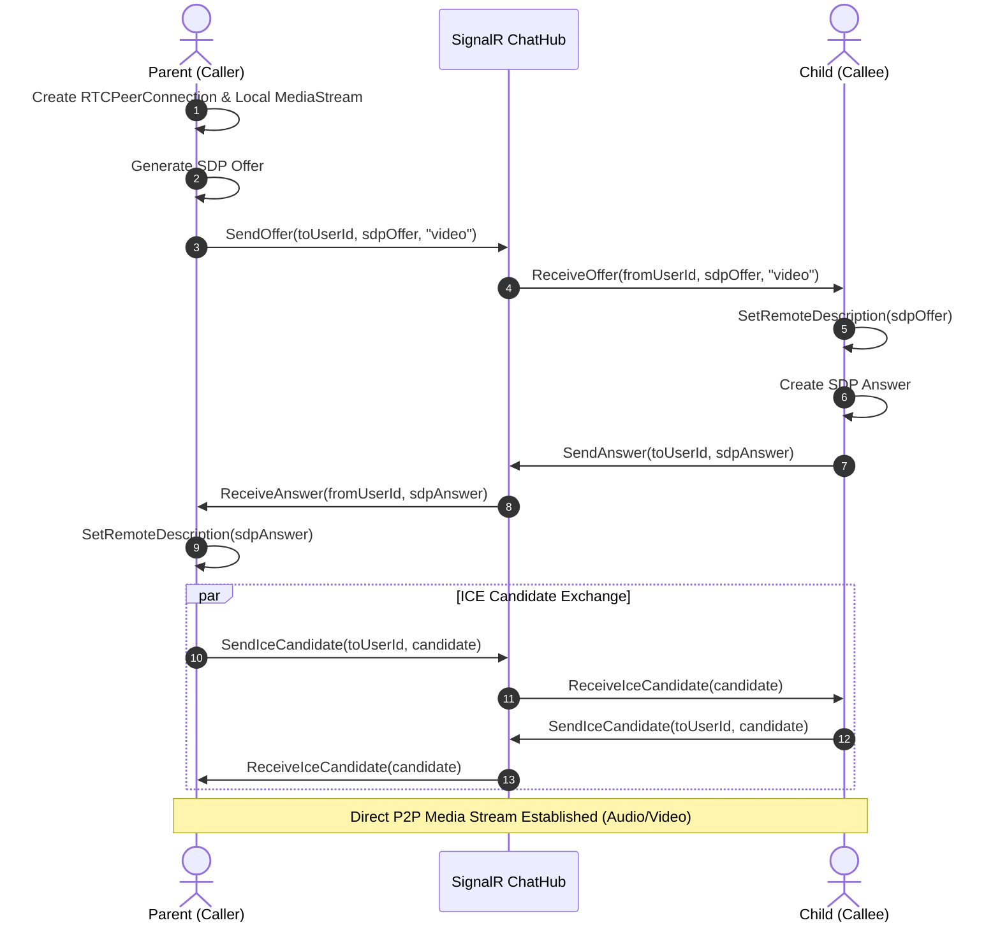

# Real-Time SignalR Hubs & WebRTC Signaling

## 1. Overview

The mobile client leverages ASP.NET Core SignalR to enable low-latency, bidirectional communication between Child devices, Parent dashboards, and the backend infrastructure. Rather than routing all events through a monolithic hub, the system isolates concerns across dedicated endpoints.

---

## 2. Hub Catalog

| Hub Endpoint | Purpose | Key Client Invocations | Key Server Events |
| :--- | :--- | :--- | :--- |
| `/locationHub` | Coordinates & Geofencing | `SendLocation`, `JoinChildGroup` | `ReceiveChildLocation`, `ChildLeftSafeZone`, `ChildEnteredDangerZone` |
| `/sosHub` | Emergency Escalation | `SendSOS`, `JoinGroup` | `ReceiveSOS`, `SOSUpdated`, `SOSDeleted` |
| `/deviceHub` | Hardware & Device Status | `JoinGroup` | `DeviceLocked`, `DeviceUnlocked`, `DeviceStatusUpdated`, `DeviceTrackingChanged` |
| `/studyHub` | Study Hours & Focus Enforcement | `JoinGroup` | `OnStudyPeriodChanged`, `StudyPeriodStarted`, `StudyPeriodStopped` |
| `/restrictionHub` | App Blocking & Firewall Sync | `JoinDeviceGroup` | `OnRestrictionChanged`, `OnFirewallToggled` |
| `/chathub` | WebRTC Signaling & Instant Messaging | `JoinGroup`, `SendOffer`, `SendAnswer`, `SendIceCandidate` | `ReceiveMessage`, `ReceiveOffer`, `ReceiveAnswer`, `ReceiveIceCandidate` |

---

## 3. Hub Descriptions & Interaction Patterns

### 3.1 LocationHub (`/locationHub`)
- **Group Isolation**: Parents join `child-{childId}` groups to receive real-time updates without polling.
- **Payload Schema**:
  ```json
  {
    "childId": "guid-string",
    "latitude": 10.7769,
    "longitude": 106.7009,
    "timestamp": "2026-11-14T11:15:00Z"
  }
  ```

### 3.2 SOSHub (`/sosHub`)
- **Reliability First**: Reconnects automatically with exponential backoff on transient network drops.
- **Handling Alert States**: Dispatches urgent sound and visual dialogs on parent devices upon `ReceiveSOS`.

### 3.3 RestrictionHub (`/restrictionHub`) & StudyHub (`/studyHub`)
- When a parent activates focus mode or adjusts restricted applications, the backend broadcasts `OnRestrictionChanged`.
- The child client parses the payload, extracts `blockedApps` (comma-separated package names), and invokes the Android platform channel to refresh native filters immediately.

---

## 4. WebRTC Audio & Video Calling Protocol

Direct peer-to-peer media streams are established using `flutter_webrtc` while utilizing the `/chathub` endpoint for SIP-style signaling:


