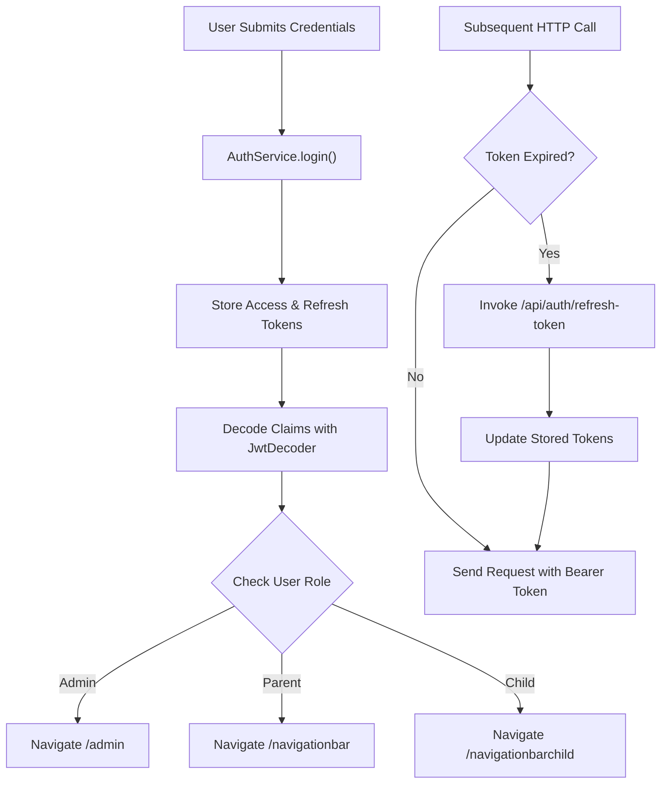

# State Management & Security Architecture

## 1. State Management Approach

QLTE uses a decoupled architecture powered by `provider` along with standard Flutter reactive patterns:

- **State Scoping**: Screen-level states utilize `StatefulWidget` for fast, localized lifecycle responses (e.g., GPS stream subscription toggles, call connection states).
- **Persistent Storage**: `SharedPreferences` securely persists authentication tokens, active `role`, `user_id`, and `child_id`.
- **Global Key Navigation**: A centralized `GlobalKey<NavigatorState>` allows background SignalR listeners to trigger dialogs or route transitions from outside the widget build context.

---

## 2. Token Lifecycle & Authentication Security

### 2.1 Role-Based Access Control (RBAC)
The app enforces access boundaries at the client level:
- **Child Mode**: Restricted view containing the SOS button, location transmitter status, class schedule, and incoming call handler. System configuration settings are restricted.
- **Parent Mode**: Full monitoring interface with live maps, safe zone setup, device lock controls, and academic scheduling.
- **Admin Mode**: High-level telemetry auditing, user account management, and active session token revocation (`admin_refresh_token_screen.dart`).

---

## 3. Communication Security

- **Transport Layer Security**: All REST endpoints and WebSocket/SignalR connections operate strictly over TLS/HTTPS and WSS.
- **Media Encryption**: WebRTC audio and video streams use DTLS-SRTP for peer-to-peer payload encryption.
- **Device Identifiers**: Hardware IDs are bound to authenticated account profiles to prevent unauthorized device impersonation.
