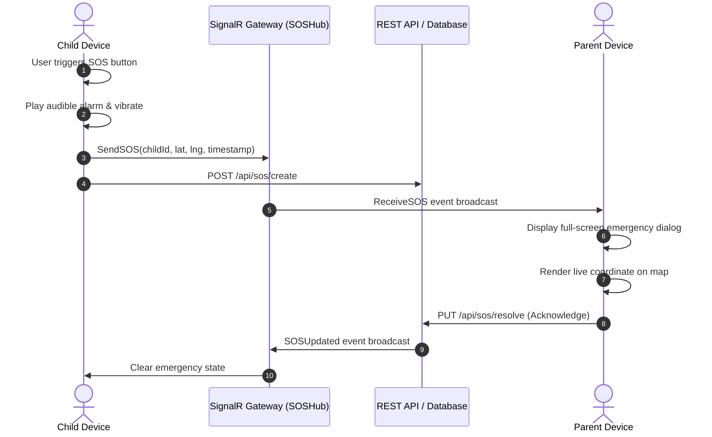

# System Design & Mobile Architecture

## 1. Overview

**QLTE** (Quản Lý Trẻ Em) is a comprehensive child safety and parental supervision mobile application built on Flutter. The application provides continuous GPS tracking, perimeter geofencing, real-time emergency alerting (SOS), app usage restrictions via native Android Accessibility services, and peer-to-peer WebRTC video and audio communications.

The system is organized around three distinct user roles:
- **Child**: Transmits location telemetry, receives parental study schedules, sends emergency SOS signals, and runs restriction guard services.
- **Parent**: Monitors children in real-time, configures safe and danger perimeters, schedules academic study blocks, restricts specific apps, and communicates via voice, video, or chat.
- **Admin**: Audits user accounts, inspects token lifecycles, and oversees platform health.

---

## 2. Architectural Layers

The Flutter client employs a clean, layered architectural approach:

```
+-----------------------------------------------------------+
|                      Presentation                         |
|   (Screens: Auth, Parent Dashboard, Child View, Admin)    |
+-----------------------------------------------------------+
                            |
+-----------------------------------------------------------+
|                    State & Navigation                     |
|           (Provider, Navigator, Global Keys)              |
+-----------------------------------------------------------+
                            |
+-----------------------------------------------------------+
|                      Service Layer                        |
|   (AuthService, LocationService, SignalRService, WebRTC)  |
+-----------------------------------------------------------+
              |                             |
+---------------------------+ +-----------------------------+
|    Native Platform Bridge | |      Network & Transport    |
| (Android MethodChannel /  | |   (HTTP REST, 5 SignalR     |
|   Accessibility Service)  | |     Hubs, WebRTC P2P)       |
+---------------------------+ +-----------------------------+
```

---

## 3. Core Modules & Responsibilities

### 3.1 Authentication & Security
- **JWT & Token Refresh**: Manages short-lived access tokens and persists refresh tokens in local storage.
- **Google OAuth 2.0 Integration**: Supports native single sign-on via Google credentials.
- **Role-Based Routing**: Dynamically directs users to role-specific interfaces immediately upon authentication.

### 3.2 Real-time Telemetry & Geofencing
- **Location Poller**: Samples GPS coordinates at set intervals using device positioning hardware.
- **Perimeter Checking**: Evaluates coordinates against predefined Safe Zones and Danger Zones.
- **SignalR Telemetry Pipeline**: Pushes coordinate streams to the server, which immediately fans out events to paired parent devices.

### 3.3 Emergency SOS Pipeline
- **Immediate Broadcast**: Sends high-priority alert packets to the SOS hub.
- **Audio & Haptic Feedback**: Automatically initiates local audible alarms and device vibration.
- **Parent Notification**: Wakes up parent interfaces with interactive maps and direction prompts.

### 3.4 Android Device Governance & Accessibility Service
- **MethodChannel Integration**: Passes lists of restricted application package names from Flutter to native Kotlin code.
- **Accessibility Service (`MyAccessibilityService`)**: Monitors foreground window transitions and automatically redirects the child to the home screen if an unauthorized package is detected during study hours.

---

## 4. End-to-End Emergency SOS Workflow


